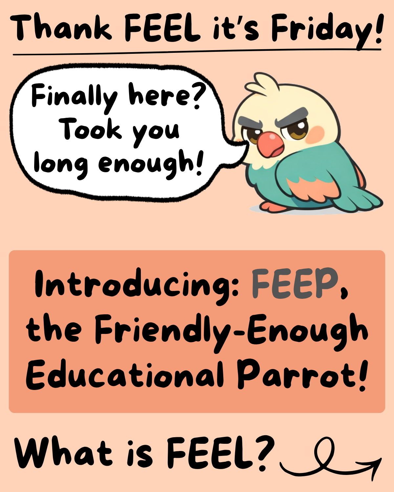

# FEEL Fundamentals
A centralized resource for FEEL (Friendly Enough Expression Language) fundamentals, focused on Camunda 8. Contains markdown explanations, practical snippets, and examples for BPMN, DMN, and forms. Ideal for learning, reference, and collaboration.

# whoami
Hello there,
I like BPMN, but I love FEEL!

In BPMN, there are often many good solutions, and as many opinions as people involved.
While there can also be multiple solutions in FEEL for a specific problem, it is easier to argue that one solution is the best.
Call chain or multi-line context? Probably multi-line context. 

Creating good FEEL expression is an art. And I, or rather FEEP, is here to teach you! :)

# whoisFEEP
FEEP is the friendly-enough educational parrot!

FEEP might be a bit grumpy at times, but he shares my passion for FEEL! <3

# How To
Navigate to the subfolders, like [feel-snippets](./feel-snippets), [form-snippets](./form-snippets) and [bpmn-snippets](./bpmn-snippets/), to find various useful tips and tricks about how to apply FEEL in your project.