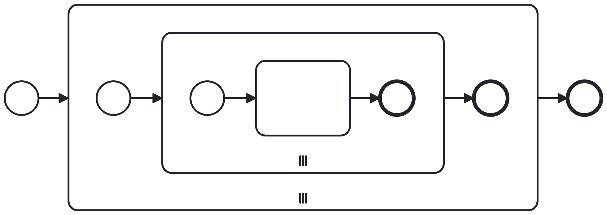
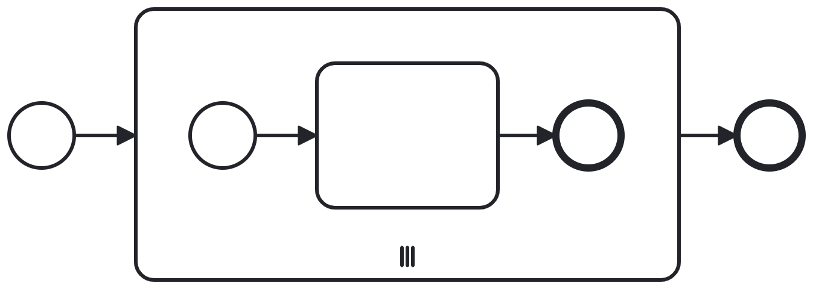

# Nested Multi-Instance Subprocesses

Today's topic is about what not to do in BPMN and how FEEL can save the day!

## The Issue

See the image below. If you ever come across this modeling pattern, beware! There is a much simpler solution!



Think about it in a data perspective. You have a list of context objects. One of these objects is another list. The outer multi-instance subprocess iterates over the outer list. The inner multi-instance subprocess iterates over the inner list.

```
{
	"outerList": [
		{
			"innerList": [{...}, {...}],
			"additionalInfo": ...
		},
		{
			"innerList": [{...}, {...}],
			"additionalInfo": ...
		}
	]
}
```

But effectively, the outer iteration does not matter! There is no extra step in the model that operates on the level of the outer iteration!

In the "wrong" model, the outer `input collection` would be `=outerList`. The `input element` can be named `outerItem`. The inner `input collection` would be `=outerItem.innerList`. The additional information would be available in each iteration instance.

## The Solution

### Case 1: Additional Info does not matter

In the simplest case, the additional information does not even matter. So let's flatten the lists.

```
// flatten lists
flatten(outerList.innerList)
```

`outerList.innerList`? Let's take a closer look at that!

What we do here is called projection. The outer element is a list of context objects. By accessing a field of that context object through the list, we create a list of projected items. For each item, the field is extracted and put into a new list.

```
// outerList.innerList
[
	[{...}, {...}], // innerList value 1
	[{...}, {...}]  // innerList value 2
]
```

Once we flatten, we get:

```
// flatten(outerList.innerList)
[
	{...},
	{...},
	{...},
	{...}
]
```

Now, we simply need to adjust our BPMN model. We only need one multi-instance subprocess! Our input collection is `=flatten(outerList.innerList)`!



### Case 2: Additional Info does matter

By just flattening the lists, we lost the `additionalInfo` we had in each outer item. In this case, the approach is the same, just the flattning is a bit more complex.

We can't project. So, we start by iterating through the outer items:

```
// iterate through outer list
for outerItem
in outerList
return ...
```

With this FEEL expression, we are creating a new outerList. 

Let's also iterate over the inner list:
```
// iterate through outer list and inner list
for outerItem
in outerList
return
  for innerItem
  in outerItem.innerList
  return ...
```

With this FEEL expression, we are creating nested lists.

If we simply returned innerItem here, we effectively did the projection by hand. Instead, we want to save `additionalInfo`.

```
// iterate through outer list and inner list and merge contexts
for outerItem
in outerList
return
  for innerItem
  in outerItem.innerList
  return
    context merge([
      innerItem,
      {
        "additionalInfo": outerItem.additionalInfo
      }
    ])
```

This is results in the following data structure:
```
// nested returns with merged contexts
[
	[
		{
			"additionalInfo": ..., // additionalInfo from outerListItem 1
			...                    // unique innerItem
		}, 
		{
			"additionalInfo": ..., // additionalInfo from outerListItem 1
			...                    // unique innerItem
		}
	], 
	[
		{
			"additionalInfo": ..., // additionalInfo from outerListItem 2
			...                    // unique innerItem
		}, 
		{
			"additionalInfo": ..., // additionalInfo from outerListItem 2
			...                    // unique innerItem
		}
	]
]
```

Now, we simply need to flatten our result.
```
// flatten + iterate through outer list and inner list and merge contexts
flatten(
  for outerItem
  in outerList
  return
    for innerItem
    in outerItem.innerList
    return
      context merge([
        innerItem,
        {
          "additionalInfo": outerItem.additionalInfo
        }
      ])
)
```

And our final data structure:
```
// flatteend nested returns with merged contexts
[
	{
		"additionalInfo": ..., // additionalInfo from outerListItem 1
		...                    // unique innerItem
	}, 
	{
		"additionalInfo": ..., // additionalInfo from outerListItem 1
		...                    // unique innerItem
	}
	{
		"additionalInfo": ..., // additionalInfo from outerListItem 2
		...                    // unique innerItem
	}, 
	{
		"additionalInfo": ..., // additionalInfo from outerListItem 2
		...                    // unique innerItem
	}
]
```

And this data is ready to go as the input collection for our one multi-instance subprocess!