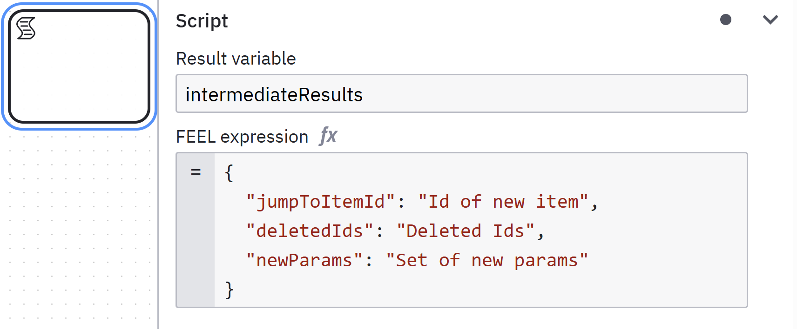

# Next Level Script Tasks

## Script Tasks and Multiple Variables

Script tasks can be confusing!

Do you want to set a single variable? Set it as the result variable.

Do you want to set more than one variable at the same time? Careful! If you set one variable as the result variable and the other in the output mapping, your result variable is gone! If you have output mapping defined, the result of the script task itself is set as a local value. It will not propagate to the parent scope. So, you have to also set the result variable as a dummy output mapping to keep it alive!

There are several options to avoid this mistake. Just find your style:

* always add the dummy output mapping
* put a dummy value in the script itself and just use the output mapping
* use a none intermediate event, not a script task and use the output mapping

## One Step Further

Let's leave this simple use case behind! 

If you have a super complex calculation, the described behaviour of script tasks is great! I am talking about intermediate results and good debug behaviour.

### The Issue

In my project, I had a difficult requirement to fulfill. Looking at a list of completed work items, please go back to a specific work item and delete all items in between. Put the deleted items back on the stack of open work items. When entering the new work item, make sure certain parameters are set,... And so on.

So, we have several variables to manipulate. But they also depend on one another. If I clean up the completed work items in one step, I don't know what to add back to the open work items.

Clearly, we should do this in one step, in one script task.

### The Setup

In my solution, I use the script task itself to calculate intermediate results and present them as a context object.

`immediateResults.deletedIds` can be used to delete the ids from the completed work items, while also adding them to the open work stack.

The output mappings can access all the intermediate results and do their thing. Beautiful!

### Debugging

In Operate, you can see the immediate results by clicking on the script task. This helps with debugging! Context objects in general are great for debugging! 

Due to the detailed immediate results, the FEEL expressions for the output mappings become less complex. The more immediate results you create, the simpler the output mappings become. And the more you can benefit when debugging.

### Variable Size

In my solution, I did not add entire lists of objects in my immediate results. I just used the ids. In the end, this simplified my expressions more than I thought was possible! The immediate results also remain readable in Operate, and you're not wasting disk space! :)

### Final Words

Make use of this immediate result functionality for your complex script tasks! When you are setting multiple variables in one step, chances are that they share some common intermediate results!