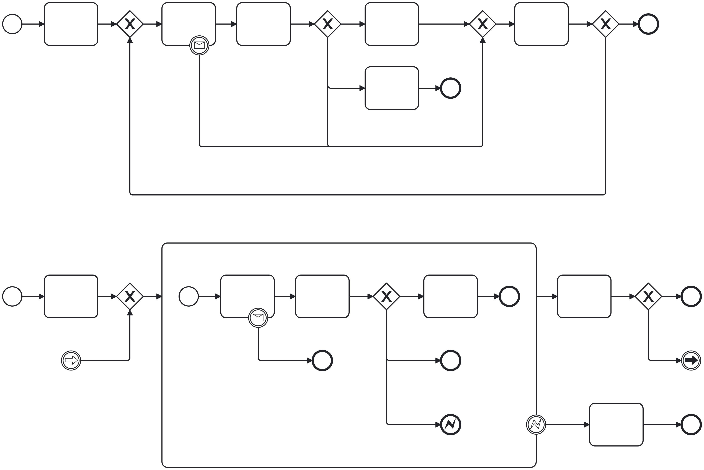

# Respect the Scope

In a complex BPMN model, variable scopes are essential. There are various practical reasons for that.

1. Reducing the number of root-level variables
2. Saving important data from being overwritten
3. Ensuring data integrity (Camunda variable merge vs. replace bug)

## Reducing Root-Level Variables

### A Context Context Object

In most processes, it is useful to introduce a process context: a context object that keeps all static data of the process.

My recommendation is to use a collapsed subprocess at the start of a process to create this context. You can use the scope of the subprocess to keep fetched variables from spilling over into the root scope. Unfortunately, this often means that you first need to set fetched variables as local variables to then add them to the context. In case of connectors, the result expression is isolated and can't access existing variables. So, you can't use the result expression to add the fetch data to the context. You also can't use a nested key like `myContext.newVariable` to set a new entry in the existing context -> would be a useful feature @Camunda ;)

For now, we might have some duplicate data in our context subprocess. But this approach keeps your root scope clean.

### Identifying Subprocesses

In the first draft of your BPMN model, you might not have introduced subprocesses yet. There are various indications that the introduction of a subprocess is in order. This can be related to the logic of the process flow, but it can also be related to data.

Please model explicitely in your first draft. That means, add every merging gateway. For more details, check out my [Interactive BPMN Tools](https://camunda-consulting.github.io/interactive-bpmn-tools/#/explicit-modeling). In this step, it is also important to model aesthetically! You want your model to tell you where the subprocesses should be!

Now, take the logic of the process flow and your data into consideration:

* potential subprocesses often end at merging gateways. This comes with the opportunity to use event-based modelling
  * introduce end events for the flows that merge in that gateway
  * introduce errors or escalations for the flows that take other paths
  * does your process data also follow this scope? Is there a data entity that "ends" with that gateway?
* the start of a potential subprocess is often flexible. Here is some guidance
  * is there a large-scale retry mechanism?
  * do you have another merging gateway which you can't incoorporate into the new subprocess?
  * is your scoped data entity introduced at some activity?

Introducing a subprocess in such a manner and taking care of its variable scope can greatly improve the BPMN model's quality. Readability of the model, opeartions in Operate, business intelligence with Optimize, etc.

## Saving Important Data from being Overwritten

If you have some kind of loop in your process model that can't be modeled with a multi-instance subprocess, you need to be careful with the scope of your variables!

Take a look at the model above. In the version at the top, looking at the data of some prior loop, you will only be able to see local variables, if there are any. Often, the local data is insufficient to debug your process. What exactly did the output mapping produce? You don't know, it was overwritten.

In the bottom version, you can introduce a scoped variable for each subprocess instance. Now, regardless of the number of loops, you can always check that variable in Operate.

### Ensuring Data Integrity

Camunda introduced a major bug in 8.8.23 and 8.9.1, where setting a context object variable did not replace the prior value, but merge with it.

In the top version of the model above, a context object of a prior loop might "spill over" to the next loop.

In the bottom version, this cab't happen. The scoped context objects are separate entities.

#### Temp Data

Even if you have to access such a scoped variable, e.g., in an error scenario, you should not change to scope to root, just to access it outside the subprocess. Instead, introduce a root-scope temp variable. In case of the error path in the model above, you would need to introduce a script task before the error end event to set this root-scope temp variable. The output mapping on the error end event does not work!